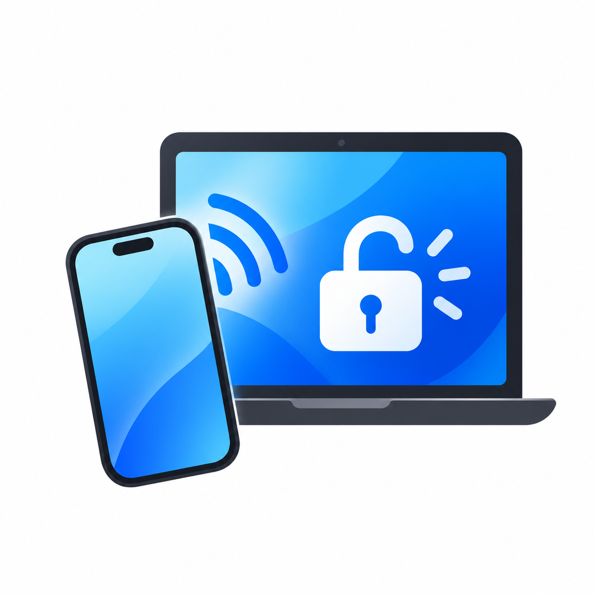

<!-- Created by Rui MA on 26 Sep 2026 -->
> [!WARNING]
> **Developer technical preview**
>
> - **Currently supports only Windows users who sign in with a Microsoft account (MSA).** The account must have a password. Local Windows accounts are not supported. See Microsoft's guide to [switching from a local account to a Microsoft account](https://support.microsoft.com/en-us/accounts-billing/manage/change-from-a-local-account-to-a-microsoft-account-in-windows).


<p align="center">
  
</p>

<p align="center">
  <a href="https://github.com/dennis6481/unlock-windows-with-iphone/releases">
    
  </a>
  <a href="https://buymeacoffee.com/dennis6481">
    
  </a>
</p>

# Unlock with iPhone®

Unlock Windows session using your iPhone in proximity.

## Get started

### System requirements

The *Unlock with iPhone* requires Windows 10 version **2004, build 19041**, or later, including Windows 11. Both x64 and ARM64 architecture are supported (althought the app has not yet been tested on a physical ARM64 machine).

Your PC must have Bluetooth enabled, with an adapter and driver that support **BLE Central, protected GATT access and advertisement scanning**.

## What it does

- Unlock your locked Windows session using your paired iPhone over Bluetooth. Select the phone unlock tile on the Windows lock screen; click **Unlock** to request a fresh presence check. The phone needs no action for each attempt; locking the PC alone does not request unlock.
- Adjust **Signal threshold** on the Windows **Status** page. Dragging changes a pending value; **Save** requests UAC.
- **Last Unlock** shows the last successful phone unlock and its signal, for example `2 min ago / -58 dBm`. It resets when the service or PC restarts.
- Keep an encrypted copy of your Microsoft account password on your PC. Your password is never sent to your iPhone.
- Manage system pairing, the product binding and saved password from the Windows tray app. The LocalSystem service verifies presence independently when the desktop app exits.
- Install, update or remove the Windows app using its installer.

After restarting your PC or signing out, sign in once with your usual Windows password or PIN before using iPhone unlock again.


### Installation

> [!WARNING]
> If a version earlier than **1.0.0** is installed, uninstall it in Windows **Settings → Apps** first, then run this installer. 

1. Get the native x64 or ARM64 [Windows installer](https://github.com/dennis6481/unlock-windows-with-iphone/releases) and follow its steps. After restarting, sign in once with your usual Windows password or PIN, then choose **Start setup**.
2. Save your **Microsoft account password**, not your PIN. The encrypted copy stays on this PC and is never sent to the phone.
3. On **Status**, use **Open Bluetooth settings** to pair your iPhone. Compare the Bluetooth numbers on both devices and accept only a match. Skip this step if Windows already shows the phone as paired.
4. Return to **Status**, select your iPhone from the updated paired-device list and click **Bind selected device**. Windows records with the same device container are combined into one named entry. Devices are never bound automatically.
5. Confirm the selected phone and **Initial signal threshold**. UAC permits the service to verify pairing, protected BLE communication and signal strength before saving the binding.

## Uninstall

Open Windows **Settings → Apps**, find *Unlock with iPhone* and select **Uninstall**. Follow the uninstaller's instructions, including restarting if prompted.

Uninstalling removes the Windows components, the Start Menu shortcut, the saved password copy and the product binding stored on your PC. It does not change your Microsoft account password. If you reinstall, you will need to set up the app again.

Windows system Bluetooth pairing is kept. Remove it separately in Windows Bluetooth settings if desired.

## Repository guide

```text
.
├── windows/       Desktop app, credential service, Credential Provider, installer, shared code and C++ tests.
├── docs/          README logo.
├── PROTOCOL.md    Service-owned presence authorization and overall architecture.
└── SECURITY.md    Credential protection, security assumptions and limitations.
```

The [Windows module index](windows/README.md#module-index) explains the source directories. Source modules are not separate installed programs.

## Build and set up

- [Windows: prerequisites, build, installation and setup](windows/README.md)

Do not mix service, Credential Provider and desktop binaries from different builds.

Windows distribution is a single `windows/dist/UnlockWithIPhone_<version>_<architecture>_setup.exe` with the desktop app, service and Credential Provider embedded. 


## Known limitations

- **Windows sessions and accounts:** Currently, only Microsoft Account (MSA) accounts are supported; local Windows accounts are not supported. Account changes or an outdated saved password can cause native authentication to fail.
- **Multi-users:** The Windows app does not currently support multi-users. I can only be configured for one MSA user on the PC.

## To Do

- [x] Modernize the Windows UI and setup guidance
- [ ] Support multiple Windows users.
- [ ] Support local Windows accounts.
- [ ] watchOS supported.
- [ ] Move Windows installer packaging to an MSI architecture.
- [ ] Investigate LSA-based Windows authentication to replace the current implementation that stores a local Windows password copy.

## Security

Inspired by the fact that an Apple Watch can unlock a Mac seemlessly, the software is an exploration for the possibility to unlock Windows PC with an iPhone (or Apple Watch). Therefore this is not a commercial or professional secutity solution. I will deny all the liabilities in case of security breach. 
Please refer to [SECURITY.md](SECURITY.md) for more details.

## Contributions

A contribution is welcome. Feel free to open an issue if you would like to continue where I've left off, or simply if you found some bugs, or some improvements.

## License and acknowledgements

The project uses the [MIT License](LICENSE.md). This is an independent project; product names identify the platforms it works with.

## References

- [Microsoft: Credential Providers](https://learn.microsoft.com/en-us/windows/win32/secauthn/credential-providers-in-windows)
- [Apple: ANCS specification](https://developer.apple.com/library/archive/documentation/CoreBluetooth/Reference/AppleNotificationCenterServiceSpecification/Specification/Specification.html)

- [Microsoft: Credential Provider system user array](https://learn.microsoft.com/en-us/windows/win32/api/credentialprovider/nf-credentialprovider-icredentialprovidersetuserarray-setuserarray)
- [Microsoft: MSBuild for Visual C++](https://learn.microsoft.com/en-us/cpp/build/msbuild-visual-cpp)
- [Microsoft: /MD and /MT runtime linkage](https://learn.microsoft.com/en-us/cpp/build/reference/md-mt-ld-use-run-time-library)
- [Microsoft: Finding and loading resources](https://learn.microsoft.com/en-us/windows/win32/menurc/finding-and-loading-resources)
- [Privacy Policy](https://dennis6481.github.io/unlock-windows-with-iphone/)
