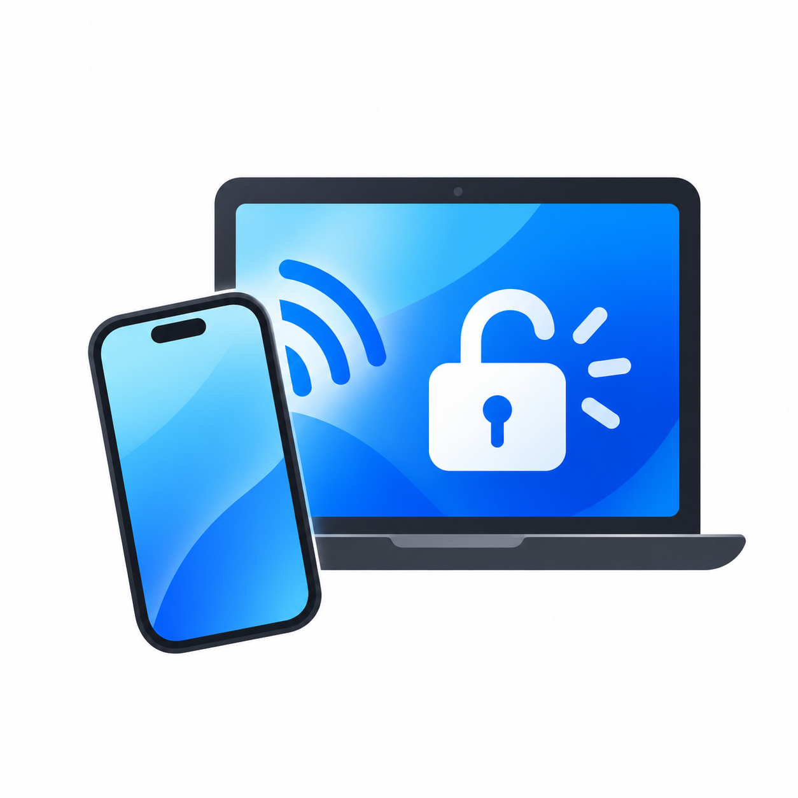

<!-- Created by Rui MA on 26 Sep 2026 -->
> [!WARNING]
> **Read before downloading**
>
> Unlock with iPhone does not provide the same user verification as Windows Hello.
>
> - Unlocking does not require Face ID, Touch ID, or confirmation on your iPhone.
> - Someone with physical access to your PC may be able to unlock it while your paired iPhone is nearby, even when the phone is locked.
> - Bluetooth signal strength is not a secure measure of distance and does not provide protection against relay attacks.
>
> Unlock with iPhone is a convenience feature, not a security upgrade. Only continue if you accept the trade-off.
> 
> See [SECURITY.md](SECURITY.md) for details.


<p align="center">
  
</p>

<p align="center">
  <a href="https://github.com/dennis6481/unlock-windows-with-iphone/releases"></a>
  <a href="https://hub.xerj.org/contributors/dennis6481"></a>
  <a href="https://sonarcloud.io/project/overview?id=dennis6481_unlock-windows-with-iphone"></a>
  <a href="https://buymeacoffee.com/dennis6481"></a>
</p>


# Unlock with iPhone®

Unlock your Windows session with your nearby iPhone.

## Get started

### System requirements

*Unlock with iPhone* requires Windows 10 version **2004, build 19041**, or later, including Windows 11. Both x64 and ARM64 architectures are supported.

Your PC must have Bluetooth enabled, with an adapter and driver that support **BLE Central, protected GATT access and advertisement scanning**.

A Windows account with a nonempty password is required. No iPhone app is needed.

## What it does

- Unlock your locked Windows session using your paired iPhone over Bluetooth. Select the phone unlock tile on the Windows lock screen; click **Unlock** to request a fresh presence check. The phone needs no action for each attempt; locking the PC alone does not request unlock.
- Adjust **Unlock range** on **Status**: **Near**, **Medium** or **Far**. Changes request UAC; signal strength does not indicate an exact distance.
- **Last Unlock** shows the last successful phone unlock and its signal, for example `2 min ago / -58 dBm`. It resets when the service or PC restarts.
- Keep an encrypted copy of your Windows account password on your PC. Your password is never sent to your iPhone.
- Manage system pairing, the product binding and saved password from the Windows tray app. The LocalSystem service verifies presence independently when the desktop app exits.
- Install, update or remove the Windows app using its installer.

Phone unlock requires an existing, locked Windows session. Windows Automatic Restart Sign-On (ARSO) may create one during startup, making phone unlock available immediately after boot. Without an existing session, including after sign-out, sign in with your usual Windows password or PIN first. See [Windows session behavior](SECURITY.md#windows-boundaries).


### Installation

> [!IMPORTANT]
> If a version earlier than **1.0.0** is installed, uninstall it in Windows **Settings → Apps** first, then run this installer. 

1. Sign in as the Windows user you want to configure, then get the native x64 or ARM64 [Windows installer](https://github.com/dennis6481/unlock-windows-with-iphone/releases) and follow its steps. After restarting, sign back in as that user and choose **Start setup**.
2. Save your **Microsoft account password** or **local Windows account password**, not your PIN. The encrypted copy stays on this PC and is never sent to the phone.
3. On **Status**, use **Open Bluetooth settings** to pair your iPhone. Compare the Bluetooth numbers on both devices and accept only a match. Skip this step if Windows already shows the phone as paired.
4. Return to **Status**, select your iPhone from the updated paired BLE list and click **Bind selected device**. Each BLE endpoint has its own entry; names do not select identity. Devices are never bound automatically.
5. Approve the Windows administrator prompt (UAC) to finish binding. **Unlock range** starts at **Medium (−60 dBm)** and can be adjusted on **Status** after binding.

If you choose **Later**, open **Unlock with iPhone** from the Start Menu or tray. On **Password**, expand **Manage saved password** and choose **Save**, then return to **Status** to pair and bind your iPhone.

## Using phone unlock

1. Keep Bluetooth enabled on both devices, bring your iPhone nearby and press **Win + L** to lock Windows.
2. On the Windows sign-in screen, open **Sign-in options** if needed, select **Unlock with iPhone** and click **Unlock**. Wait for verification and Windows sign-in to complete.

Your iPhone can stay locked. The Windows app does not need to remain open.

## Manage your password and iPhone

- **Update the saved password:** After changing your account password, renaming the account or switching between Microsoft and local sign-in, open **Password → Manage saved password → Update**. This updates only the saved copy, not your Windows account password. Saving confirms storage; try a phone unlock to check that Windows accepts the password.
- **Remove the saved password:** On **Password**, expand **Manage saved password** and use **Remove** under **Remove saved password**. Phone unlock is unavailable until you save a password again.
- **Change iPhone:** On **Status**, use **Remove** under **Remove bound iPhone**, then pair and bind the new phone. Removing the product binding keeps your saved password and Windows Bluetooth pairing.

## Troubleshooting

- **iPhone not listed:** Check that Bluetooth is enabled on both devices and pair the phone in Windows Bluetooth settings, then return to **Status**.
- **Unlock fails:** Read the error on the Windows sign-in screen and use your usual PIN or password to sign in. For missing setup, save your password on **Password** and pair/bind your iPhone on **Status**, as indicated. For a signal-strength failure, bring the phone closer or adjust **Unlock range**. If Windows rejects an incorrect or outdated password, update the saved copy on **Password**.
- **Phone unlock option missing:** Complete any restart requested by the installer, sign in as the configured Windows user and lock the existing session again.
- **Report a problem:** Open **Diagnostics** and click **Copy logs**. Remove personal and device identifiers before sharing the logs and displayed error in your issue report.

## Uninstall

Open Windows **Settings → Apps**, find *Unlock with iPhone* and select **Uninstall**. Follow the uninstaller's instructions, including restarting if prompted.

Uninstalling removes the Windows components, the Start Menu shortcut, the saved password copy and the product binding stored on your PC. It does not change your Windows account password. Deletion is irreversible even if later removal fails. After uninstalling, a fresh installation requires setup again.

Windows system Bluetooth pairing is kept. Remove it separately in Windows Bluetooth settings if desired.

## Repository guide

```text
.
├── windows/       Desktop app, credential service, Credential Provider, installer, shared code and C++ tests.
├── docs/          README logo.
├── PROTOCOL.md    Service-owned presence authorization and overall architecture.
└── SECURITY.md    Credential protection, security assumptions and limitations.
```

The [Windows module index](windows/README.md#module-index) explains the source directories. Source modules are not separate installed programs.

## Build and set up

- [Windows: prerequisites, build, installation and setup](windows/README.md)

Do not mix service, Credential Provider and desktop binaries from different builds.

Windows distribution consists of self-contained x64 and ARM64 `dist/UnlockWithIPhone_<version>_<architecture>_setup.msi` packages. The product version uses `major.minor.patch.build`; filenames omit build. Higher fourth parts update, identical four-part versions reinstall and lower versions are rejected. Updates and repairs preserve credentials and binding.


## Known limitations

- **Multiple users:** The Windows app can currently be configured for only one Windows user on the PC. Updates and reinstalls keep the configured user. To change users, uninstall first, then sign in as the new user and install again.

## To Do

- [x] ~~Modernize the Windows UI and setup guidance. [#21](https://github.com/dennis6481/unlock-windows-with-iphone/issues/21).~~
- [x] ~~Support local Windows accounts. [#18](https://github.com/dennis6481/unlock-windows-with-iphone/issues/18).~~
- [ ] Support multiple Windows users. [#24](https://github.com/dennis6481/unlock-windows-with-iphone/issues/24).
- [ ] Add support for Apple Watch. [#23](https://github.com/dennis6481/unlock-windows-with-iphone/issues/23).
- [ ] Investigate LSA-based Windows authentication to replace the current implementation that stores a local Windows password copy. [#22](https://github.com/dennis6481/unlock-windows-with-iphone/issues/22).
- [x] ~~Evaluate Windows Installer (MSI) to simplify installation, upgrades and maintenance. [#25](https://github.com/dennis6481/unlock-windows-with-iphone/issues/25).~~

## Security

Inspired by the way an Apple Watch can seamlessly unlock a Mac, this project explores the possibility of unlocking a Windows PC with an iPhone (or Apple Watch). It is an experimental project, not a commercial or professional security solution. Use it at your own risk; the author accepts no liability for security incidents.

Please refer to [SECURITY.md](SECURITY.md) for details about its security model and limitations.

## Contributions

Contributions are welcome. Feel free to open an issue if you would like to continue where I've left off, report a bug or suggest an improvement. See [CONTRIBUTING.md](CONTRIBUTING.md) for project guidelines.

## License

The project uses the [MIT License](LICENSE.md).

## References

- [Microsoft: Credential Providers](https://learn.microsoft.com/en-us/windows/win32/secauthn/credential-providers-in-windows)
- [Apple: ANCS specification](https://developer.apple.com/library/archive/documentation/CoreBluetooth/Reference/AppleNotificationCenterServiceSpecification/Specification/Specification.html)

- [Microsoft: Credential Provider system user array](https://learn.microsoft.com/en-us/windows/win32/api/credentialprovider/nf-credentialprovider-icredentialprovidersetuserarray-setuserarray)
- [Microsoft: MSBuild for Visual C++](https://learn.microsoft.com/en-us/cpp/build/msbuild-visual-cpp)
- [Microsoft: /MD and /MT runtime linkage](https://learn.microsoft.com/en-us/cpp/build/reference/md-mt-ld-use-run-time-library)
- [Microsoft: Finding and loading resources](https://learn.microsoft.com/en-us/windows/win32/menurc/finding-and-loading-resources)
